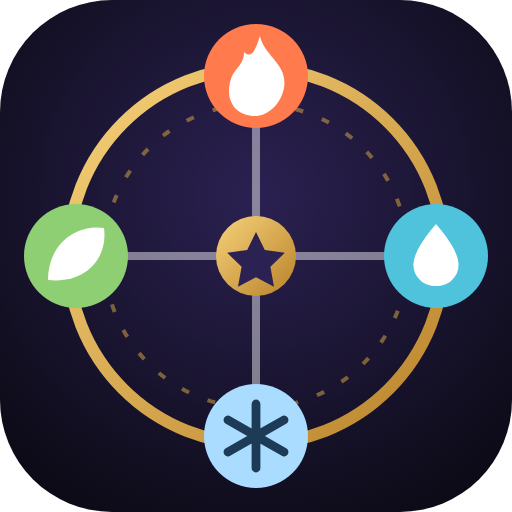

<p align="center"></p>

# ELEMENTAL: The Last Classifier

A 2D fantasy adventure that teaches **classification in data science**. You play an elemental guardian who walks through five realms, studies strange creatures by their measurements, and teaches the ancient Classifier to tell **Fire, Water, Ice and Earth** apart. Under the story, the game runs a real **K-Nearest Neighbours (KNN)** model written from scratch in JavaScript.

> Built by **Akshith Kumar** as a classification project (IDEASC). Contact: akshithkumarlakkakula@gmail.com

## Play

- **Online:** publish with GitHub Pages (see below) and open the link.
- **Locally:** download the repository and open `index.html` in Chrome, Edge or Firefox. No install, build step, server or API key is needed.

## Features

- Four playable guardians with sprites and their own element: **Kael** (Fire), **Mira** (Water), **Eira** (Ice) and **Thorne** (Earth).
- Five side-scrolling realms with a boss fight, relics and XP rewards.
- Four unlockable powers: **Fireball**, **Water Shield**, **Freeze** and **Stone Barrier**. Undiscovered powers appear as a "?" in the Codex.
- A **how-to-play briefing** before every level, covering the steps, controls, element signatures and how to win.
- An **Ancient Codex** book (turn the pages) with the guardians, powers and a glossary of classification terms.
- A **Classifier Lab** with a live decision-boundary map, an adjustable K and a train/test accuracy readout.
- **2-4 players per device**, each with their own guardian, XP, relics and unlocked powers, plus **Reset progress** and **Delete player**.
- A dramatic defeat sequence when all hearts are lost, with a retry button.

## Controls

| Key | Action |
|---|---|
| ← → or A / D | Walk |
| E | Interact (inspect creatures, tablets, altar, boss, door) |
| Space | Cast the active power |
| 1-4 or Q | Switch power (unlocked ones only) |

On touch screens, use the buttons under the arena.

## What each realm teaches

| # | Realm | Classification idea | Mechanic |
|---|---|---|---|
| 1 | The Awakening (Fire) | Features and labels | Read four feature bars and name the element |
| 2 | Kingdom of Tides (Water) | Training data quality | Find the 2 poisoned labels among 6 tablets |
| 3 | The Frozen Expanse (Ice) | Train / test split and accuracy | Classify unseen creatures and compare with the model |
| 4 | The Verdant Realm (Earth) | Decision boundaries and the choice of K | Find the K that scores best on 6 tricky creatures |
| 5 | The Corrupted Core | Noisy real-world data | Boss fight: classify disguised creatures |

## The machine-learning model

- **Algorithm:** K-Nearest Neighbours with Euclidean distance, majority vote and a distance tie-break.
- **Features (0-100):** temperature, moisture, density, energy.
- **Classes:** Fire, Water, Ice, Earth.
- **Data:** 20 labelled creatures, split deterministically into 16 training and 4 test samples.
- **Evaluation:** accuracy on the unseen test creatures, and leave-one-out checks for the K puzzle in realm 4.

```js
const dist=(a,b)=>Math.hypot(...a.map((v,i)=>v-b[i]));
function knn(f,tr,k){ /* sort training points by distance, take k, majority vote */ }
```

## Project structure

```
elemental-last-classifier/
├── index.html        page structure (screens, HUD, modal, book)
├── styles.css        all styling
├── game.js           game logic, KNN model, arena engine, Codex, players
├── assets/           realm artwork, guardian sprites, logo
├── docs/BEHIND_THE_SCENES.md   how the code works
├── README.md
└── LICENSE
```

## Publish with GitHub Pages

1. Create a repository, for example `elemental-last-classifier`.
2. Upload everything in this folder (keep the `assets` folder).
3. Go to **Settings → Pages**, choose **Deploy from a branch**, select `main` and `/ (root)`, then **Save**.
4. Your game will be live at `https://YOUR-USERNAME.github.io/elemental-last-classifier/`.

## Saving, players and reset

Progress is stored in your browser's `localStorage` (no server, no account). Use the **👤 button in the top bar** to add players, switch players, reset one player's progress or delete a player. Clearing your browser data also clears saves.

## Credits

Game design, code and project by **Akshith Kumar**. Contact: [akshithkumarlakkakula@gmail.com](mailto:akshithkumarlakkakula@gmail.com).
Artwork was supplied by the author and is used for this educational project. Replace it with your own images in `assets/` if you plan to redistribute.

Released under the MIT License (code).
