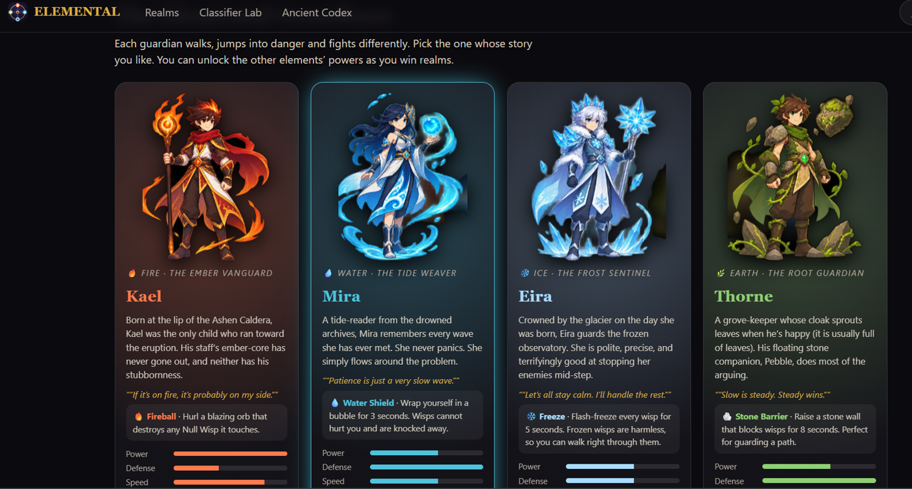
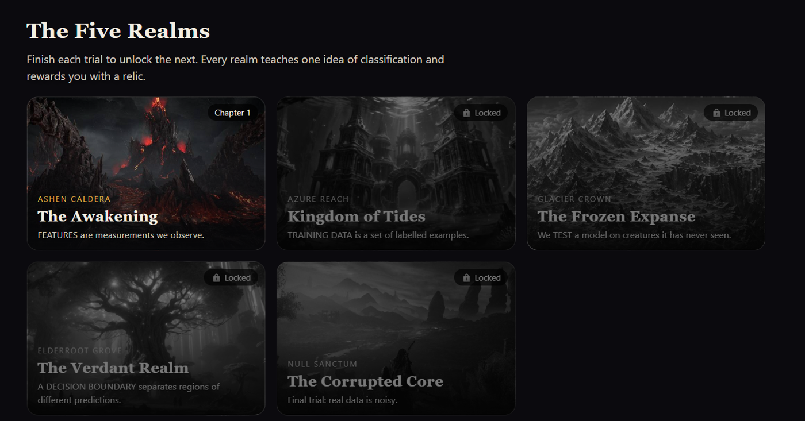
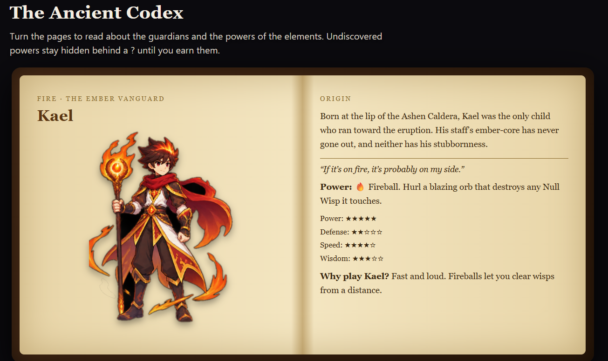
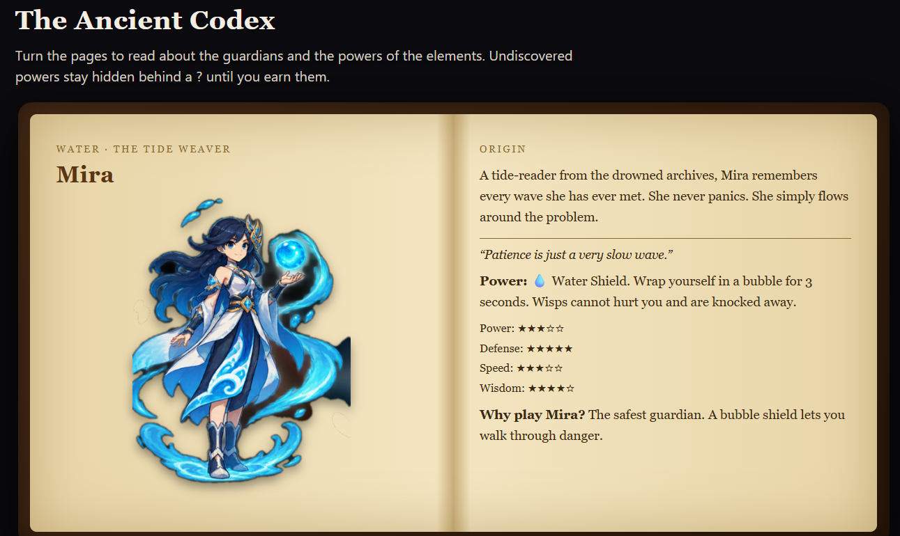

# IDSE Project: House Price Prediction + Elemental Game

[](https://akshithkumarlakkakula-ux.github.io/IDSE_Project_/)

This repository contains two machine-learning projects that cover the two classic supervised-learning tasks:

| Part | Task | What it is |
|---|---|---|
| **A. House Price Prediction System** | Regression | Predicts a house's price from its features |
| **B. Elemental: The Last Classifier** | Classification | A playable fantasy game that teaches classification with a real KNN model |

**Contents:** [Part A: House Price Prediction](#-part-a-house-price-prediction-system) · [Part B: Elemental Game](#-part-b-elemental-the-last-classifier) · [How the parts connect](#how-the-two-parts-connect) · [Project structure](#project-structure) · [Credits](#credits)

---

## 🏠 Part A: House Price Prediction System

### Problem

Estimate the sale price of a house from measurable features such as size, rooms and location. Price is a continuous number, so this is a **regression** problem.

### Approach

1. **Data collection and cleaning:** load the dataset, check missing values and duplicates, and handle outliers.
2. **Exploratory analysis:** study feature distributions and the correlation of each feature with price.
3. **Feature preparation:** encode categorical columns and scale numeric ones where the model needs it.
4. **Train/test split:** hold out unseen data so results reflect real-world performance.
5. **Model training and comparison:** train regression models and compare them on the same test data.
6. **Evaluation:** report error metrics (MAE, RMSE) and R² on the test set.
7. **Prediction:** enter a house's features and get a predicted price.

### Dataset

- **Source / name:** `[FILL: dataset name and where it came from]`
- **Size:** `[FILL: rows × columns]`
- **Target:** `[FILL: price column name and units]`
- **Key features:** `[FILL: e.g. area, bedrooms, bathrooms, location]`

### Results

| Model | MAE | RMSE | R² |
|---|---|---|---|
| `[FILL: model 1]` | `[FILL]` | `[FILL]` | `[FILL]` |
| `[FILL: model 2]` | `[FILL]` | `[FILL]` | `[FILL]` |

**Best model:** `[FILL: name and one sentence on why it won]`

### How to run

```bash
git clone https://github.com/akshithkumarlakkakula-ux/IDSE_Project_.git
cd IDSE_Project_
pip install -r requirements.txt
```

Then open the notebook or run the main script: `[FILL: exact file name and command]`.

---

## 🎮 Part B: Elemental, The Last Classifier

### ▶️ [**Play it now in your browser**](https://akshithkumarlakkakula-ux.github.io/IDSE_Project_/)

No download or install needed. It works best on a laptop or desktop with a keyboard.

A fantasy adventure that teaches **classification**. You play an elemental guardian who walks through five realms, studies strange creatures by their measurements, and teaches the ancient Classifier to tell **Fire, Water, Ice and Earth** apart. Under the story, a **K-Nearest Neighbours (KNN)** model written from scratch in JavaScript decides what each creature is.

### Gameplay

<p align="center"></p>

Walk with the arrow keys, press **E** to inspect a creature, read its four features (temperature, moisture, density, energy) and decide its element. Wisps roam each realm, so use your guardian's power to survive.

### Choose your guardian

<p align="center"></p>

| Guardian | Element | Power |
|---|---|---|
| Kael | 🔥 Fire | Fireball: destroys wisps from a distance |
| Mira | 💧 Water | Water Shield: a bubble that blocks wisps |
| Eira | ❄️ Ice | Freeze: freezes every wisp at once |
| Thorne | 🌿 Earth | Stone Barrier: raises a wall wisps cannot cross |

Each completed realm unlocks another element's power. Undiscovered powers show as a **?** until they are earned.

### Five realms, five ideas

<p align="center"></p>

| # | Realm | Classification idea | Mechanic |
|---|---|---|---|
| 1 | The Awakening | Features and labels | Read four feature bars and name the element |
| 2 | Kingdom of Tides | Training data quality | Find the 2 poisoned labels among 6 tablets |
| 3 | The Frozen Expanse | Train/test split and accuracy | Classify unseen creatures and compare with the model |
| 4 | The Verdant Realm | Decision boundaries and choosing K | Find the K that scores best on 6 tricky creatures |
| 5 | The Corrupted Core | Noisy real-world data | Boss fight against the Null Sovereign |

### The Ancient Codex

An in-game book you can page through, with each guardian's origin story, power and attributes.

| Kael, the Ember Vanguard | Mira, the Tide Weaver |
|:--:|:--:|
|  |  |

### Controls

| Key | Action |
|---|---|
| ← → or A / D | Walk |
| E | Interact (creatures, tablets, altar, boss, door) |
| Space | Cast the active power |
| 1–4 or Q | Switch power (unlocked ones only) |

On touch screens, use the buttons under the arena. The game supports up to 4 players per device, each with their own saved progress, and a **Reset progress** option.

### The classification model

- **Algorithm:** K-Nearest Neighbours with Euclidean distance and a majority vote (ties go to the closest neighbour)
- **Features (0–100):** temperature, moisture, density, energy
- **Classes:** Fire, Water, Ice, Earth
- **Data:** 20 labelled creatures, split deterministically into 16 training and 4 test samples
- **Evaluation:** accuracy on unseen test creatures, and leave-one-out checks for the K puzzle in realm 4
- **Lab:** the in-game *Classifier Lab* paints the model's decision regions live so you can see how K changes the boundary

---

## How the two parts connect

Part A is **regression** (predict a number). Part B is **classification** (predict a category). Together they cover the two main supervised-learning problems: Part A with a conventional notebook workflow, and Part B by turning the same ideas into an interactive game anyone can learn from.

## Project structure

```
IDSE_Project_/
├── images/              screenshots used in this README
├── (Part A files)       dataset, notebook / scripts, requirements.txt
├── index.html           Part B: game page
├── styles.css           Part B: styling
├── game.js              Part B: game logic and the KNN model
├── assets/              Part B: artwork, guardian sprites, logo
└── README.md
```

## Credits

Developed by **Akshith Kumar** · [akshithkumarlakkakula@gmail.com](mailto:akshithkumarlakkakula@gmail.com)
