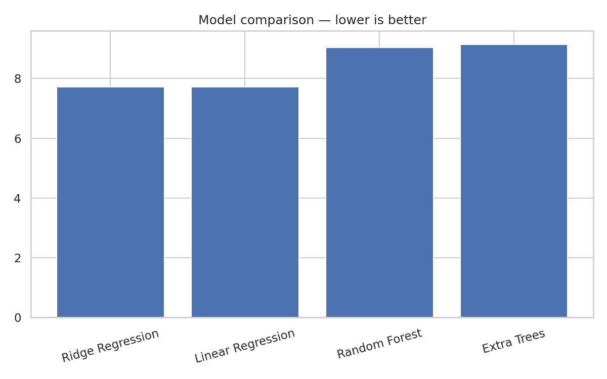
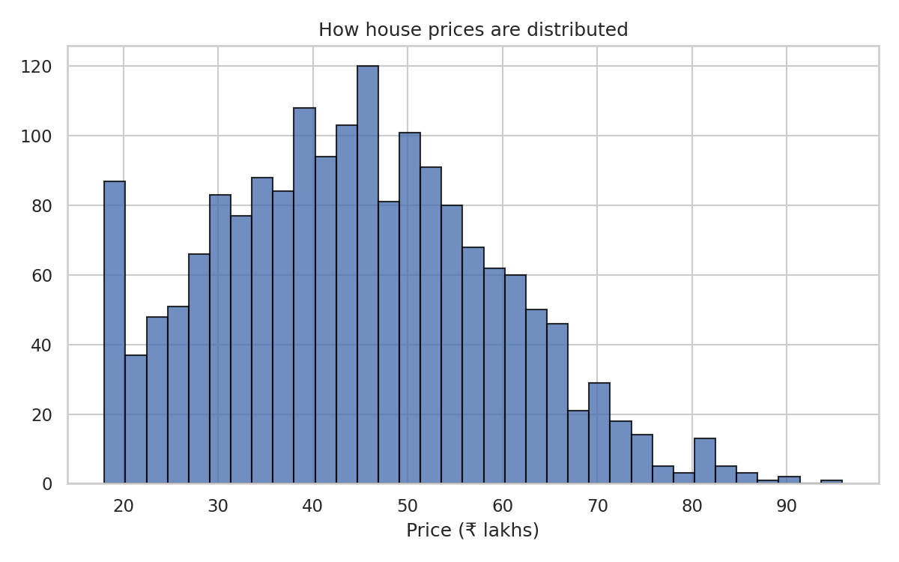
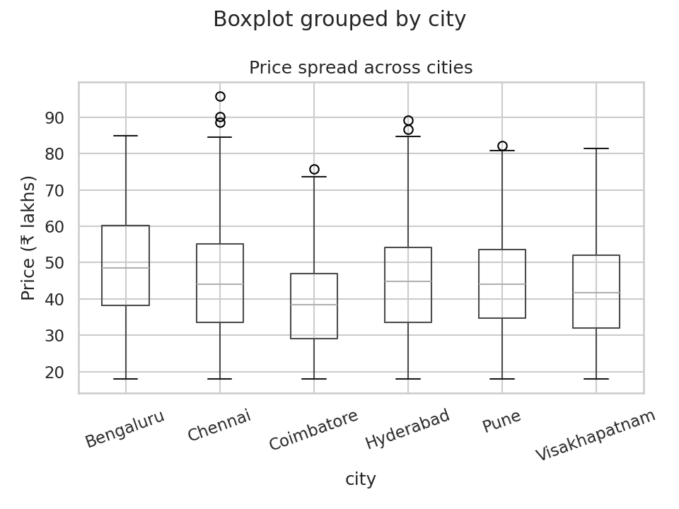
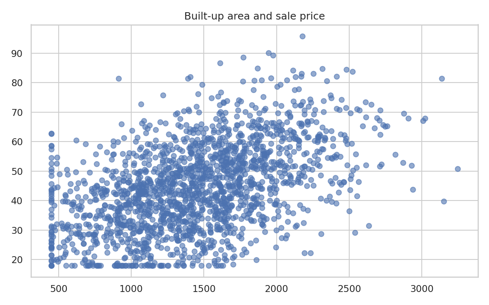
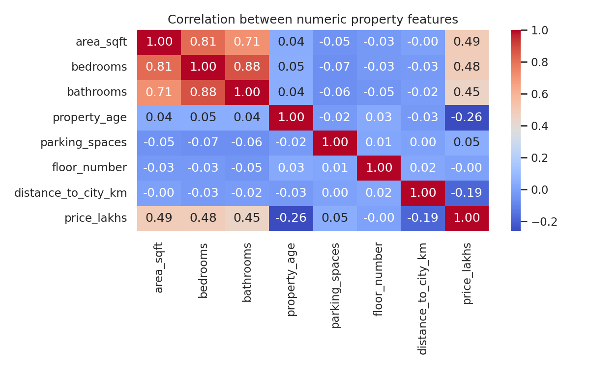
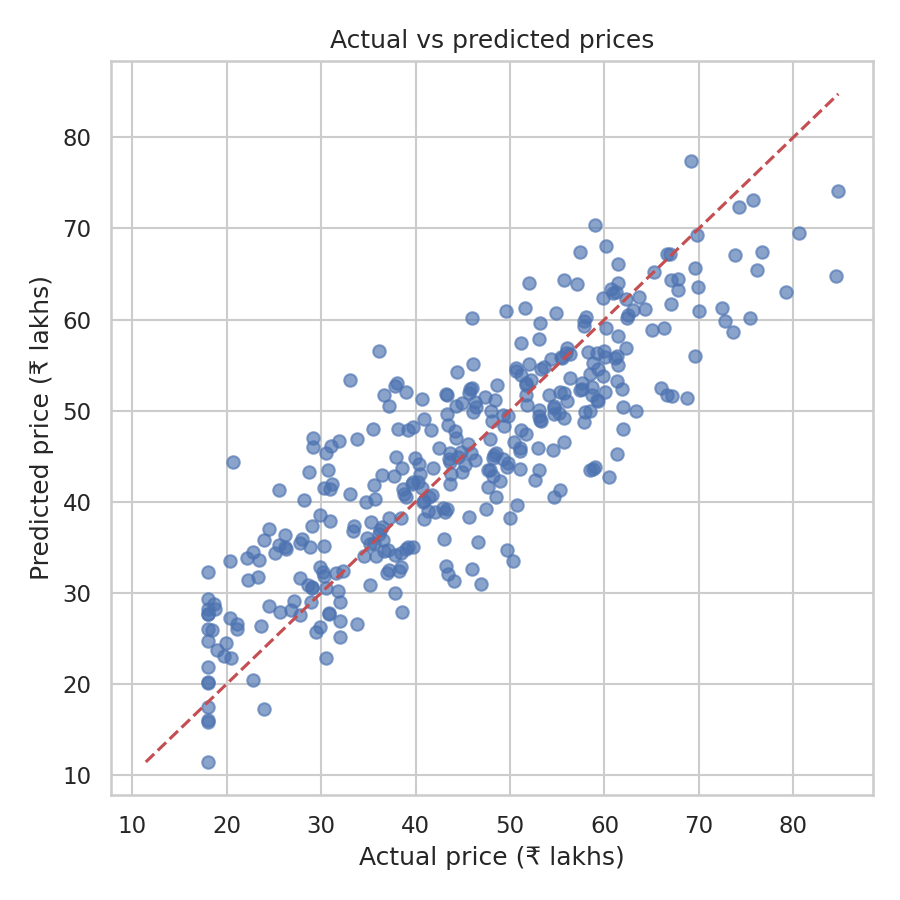
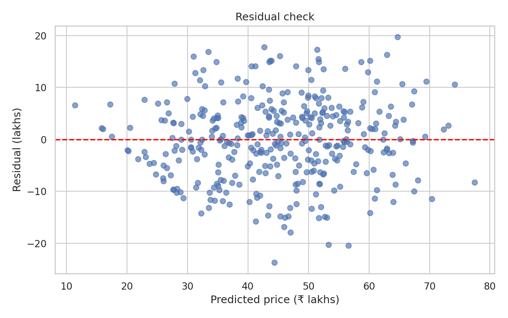
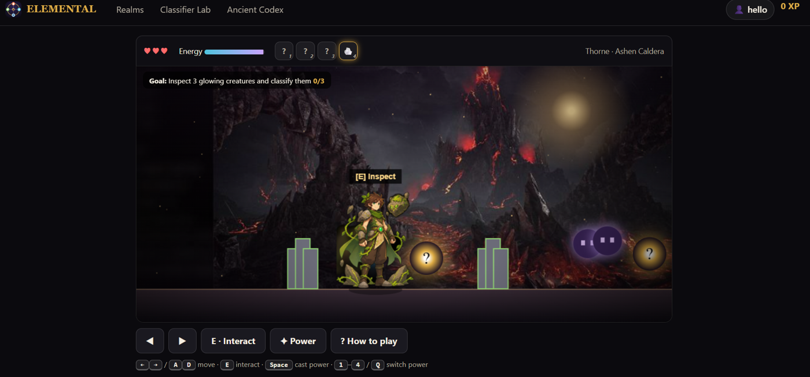

# IDSE Project: House Price Prediction + Elemental Game

[](https://akshithkumarlakkakula-ux.github.io/IDSE_Project_/)

This repository contains two machine-learning projects that cover the two classic supervised-learning tasks:

| Part | Task | What it is |
|---|---|---|
| **A. House Price Prediction System** | Regression | Predicts a house's price from its features |
| **B. Elemental: The Last Classifier** | Classification | A playable fantasy game that teaches classification with a real KNN model |

**Contents:** [Part A: House Price Prediction](#-part-a-house-price-prediction-system) · [Part B: Elemental Game](#-part-b-elemental-the-last-classifier) · [How the parts connect](#how-the-two-parts-connect) · [Project structure](#project-structure) · [Credits](#credits)

---

## 🏠 Part A: House Price Prediction System

A complete regression workflow that predicts the price of a residential property in six Indian cities from its size, location, age and amenities. The notebook takes the raw data all the way to a saved model that can price a new property in one line of code.

> **Note on the data:** the dataset is **synthetic and reproducible** (generated for this project, not real property transactions). The model is an educational demonstration and should not be used for real property decisions. Prices are in **₹ lakhs**.

### Problem

Estimate a property's price from its city, locality type, area, rooms, age, parking, furnishing and more. Price is a continuous number, so this is a supervised **regression** task.

### Dataset

| | |
|---|---|
| **Rows × columns** | 1,812 × 13 (12 exact duplicates removed, leaving **1,800 rows**) |
| **Target** | `price_lakhs` (range ₹18.0 to ₹95.8 lakhs, mean ≈ ₹44.4 lakhs) |
| **Cities** | Hyderabad, Bengaluru, Chennai, Pune, Coimbatore, Visakhapatnam |
| **Numeric features (7)** | `area_sqft`, `bedrooms`, `bathrooms`, `property_age`, `parking_spaces`, `floor_number`, `distance_to_city_km` |
| **Categorical features (5)** | `city`, `locality_type`, `furnishing_status`, `property_type`, `main_road_access` |
| **Missing values** | `parking_spaces` (22), `furnishing_status` (32), `distance_to_city_km` (46) |

### Approach

1. **Inspect and clean:** check types, missing values and duplicates; remove exact duplicates.
2. **Explore:** price distribution, city-wise spread, area vs price, and feature correlations.
3. **Prepare features (inside a Scikit-learn `Pipeline`):** numeric columns are median-imputed and standardised; categorical columns are mode-imputed and one-hot encoded. Keeping this inside the pipeline means the imputers and scaler learn **only from training data**, which avoids data leakage.
4. **Split:** 80/20 train/test split (`random_state=42`): **1,440 training rows, 360 test rows**.
5. **Compare four models** on the same split: Linear Regression, Ridge Regression (α = 2), Random Forest and Extra Trees (180 trees each).
6. **Tune:** a Random Forest was tuned with `GridSearchCV` (3-fold cross-validation over trees, depth and leaf size) and compared against the best untuned model. The tuned forest did **not** beat the simple linear model, so the simpler model was kept.
7. **Evaluate and save:** error metrics, an actual-vs-predicted plot and a residual check; the full pipeline (preprocessing + model) is saved with `joblib`.

### Results (360 unseen test properties)

| Model | MAE (lakhs) | RMSE (lakhs) | R² |
|---|---|---|---|
| **Ridge Regression** ✅ selected | **6.13** | **7.73** | **0.728** |
| Linear Regression | 6.13 | 7.73 | 0.728 |
| Random Forest | 7.19 | 9.03 | 0.628 |
| Extra Trees | 7.25 | 9.15 | 0.619 |

**Best model: Ridge Regression.** On average its predictions are off by about ₹6.1 lakhs (roughly 14% of the average price of ₹44.4 lakhs), and it explains about 73% of the variation in price on unseen data. The tree models scored lower here. A likely reason is that price in this generated dataset depends mostly on straight-line relationships with the features, which linear models capture well.

<p align="center"></p>

### What drives the price

- **Bigger homes cost more:** area (r = 0.49), bedrooms (0.48) and bathrooms (0.45) have the strongest positive link with price.
- **Older and farther costs less:** property age (r = −0.26) and distance to the city centre (−0.19) lower the price.
- **Parking and floor number** have almost no linear link with price (≈ 0.05 and 0.00).
- **City matters:** Bengaluru has the highest typical price and Coimbatore the lowest.
- Area, bedrooms and bathrooms are strongly correlated with each other (0.71 to 0.88), so they carry overlapping information.

### Visual analysis

| Price distribution | City price comparison |
|:--:|:--:|
|  |  |
| **Area vs price** | **Correlation heatmap** |
|  |  |
| **Actual vs predicted** | **Residual check** |
|  |  |

The actual-vs-predicted points follow the diagonal, and the residuals scatter around zero without a strong visible pattern, which is a good sign for a linear model.

### Try it yourself: predict a price

```python
import joblib, pandas as pd

model = joblib.load("models/house_price_pipeline.joblib")
property_df = pd.read_csv("sample_property.csv")      # one row with the 12 feature columns
print(f"Estimated price: ₹{model.predict(property_df)[0]:.2f} lakhs")
```

The included sample (a 1,450 sq. ft., 3-bedroom, 5-year-old semi-furnished apartment in Hyderabad, 6.5 km from the centre) is estimated at **₹44.57 lakhs**.

### How to run the notebook

```bash
git clone https://github.com/akshithkumarlakkakula-ux/IDSE_Project_.git
cd IDSE_Project_
pip install pandas numpy scikit-learn matplotlib seaborn joblib jupyter
jupyter notebook House_Price_Prediction.ipynb
```

The notebook reads the data from `data/indian_house_prices.csv` and writes the saved model to `models/` and the results table to `outputs/`, so keep that folder layout:

```
data/indian_house_prices.csv
models/house_price_pipeline.joblib    (and metrics.json)
outputs/model_comparison.csv
House_Price_Prediction.ipynb          (or inside notebooks/)
sample_property.csv
```

### Limitations and future work

- The data is synthetic and simplified, so scores on real markets would differ.
- Prices show a cluster at the ₹18 lakh minimum, and the linear model can predict below that floor for the cheapest homes.
- There is no precise location data (no latitude/longitude) and no time dimension.
- Future work: verified sales data, richer location features, validation across cities and years, and prediction intervals instead of a single number.

## 🎮 Part B: Elemental, The Last Classifier

### ▶️ [**Play it now in your browser**](https://akshithkumarlakkakula-ux.github.io/IDSE_Project_/)

No download or install needed. It works best on a laptop or desktop with a keyboard.

A fantasy adventure that teaches **classification**. You play an elemental guardian who walks through five realms, studies strange creatures by their measurements, and teaches the ancient Classifier to tell **Fire, Water, Ice and Earth** apart. Under the story, a **K-Nearest Neighbours (KNN)** model written from scratch in JavaScript decides what each creature is.

### Gameplay

<p align="center"></p>

Walk with the arrow keys, press **E** to inspect a creature, read its four features (temperature, moisture, density, energy) and decide its element. Wisps roam each realm, so use your guardian's power to survive.

### Choose your guardian

<p align="center"></p>

| Guardian | Element | Power |
|---|---|---|
| Kael | 🔥 Fire | Fireball: destroys wisps from a distance |
| Mira | 💧 Water | Water Shield: a bubble that blocks wisps |
| Eira | ❄️ Ice | Freeze: freezes every wisp at once |
| Thorne | 🌿 Earth | Stone Barrier: raises a wall wisps cannot cross |

Each completed realm unlocks another element's power. Undiscovered powers show as a **?** until they are earned.

### Five realms, five ideas

<p align="center"></p>

| # | Realm | Classification idea | Mechanic |
|---|---|---|---|
| 1 | The Awakening | Features and labels | Read four feature bars and name the element |
| 2 | Kingdom of Tides | Training data quality | Find the 2 poisoned labels among 6 tablets |
| 3 | The Frozen Expanse | Train/test split and accuracy | Classify unseen creatures and compare with the model |
| 4 | The Verdant Realm | Decision boundaries and choosing K | Find the K that scores best on 6 tricky creatures |
| 5 | The Corrupted Core | Noisy real-world data | Boss fight against the Null Sovereign |

### The Ancient Codex

An in-game book you can page through, with each guardian's origin story, power and attributes.

| Kael, the Ember Vanguard | Mira, the Tide Weaver |
|:--:|:--:|
|  |  |

### Controls

| Key | Action |
|---|---|
| ← → or A / D | Walk |
| E | Interact (creatures, tablets, altar, boss, door) |
| Space | Cast the active power |
| 1–4 or Q | Switch power (unlocked ones only) |

On touch screens, use the buttons under the arena. The game supports up to 4 players per device, each with their own saved progress, and a **Reset progress** option.

### The classification model

- **Algorithm:** K-Nearest Neighbours with Euclidean distance and a majority vote (ties go to the closest neighbour)
- **Features (0–100):** temperature, moisture, density, energy
- **Classes:** Fire, Water, Ice, Earth
- **Data:** 20 labelled creatures, split deterministically into 16 training and 4 test samples
- **Evaluation:** accuracy on unseen test creatures, and leave-one-out checks for the K puzzle in realm 4
- **Lab:** the in-game *Classifier Lab* paints the model's decision regions live so you can see how K changes the boundary

---

## How the two parts connect

Part A is **regression** (predict a number). Part B is **classification** (predict a category). Together they cover the two main supervised-learning problems: Part A with a conventional notebook workflow, and Part B by turning the same ideas into an interactive game anyone can learn from.

## Project structure

```
IDSE_Project_/
├── images/              screenshots used in this README
├── (Part A files)       dataset, notebook / scripts, requirements.txt
├── index.html           Part B: game page
├── styles.css           Part B: styling
├── game.js              Part B: game logic and the KNN model
├── assets/              Part B: artwork, guardian sprites, logo
└── README.md
```
## 🛠️ Tools & Technologies

| Area | Tools |
|---|---|
| Part A: data and ML | Python, pandas, NumPy, scikit-learn (Pipeline, ColumnTransformer, GridSearchCV), joblib |
| Part A: visualisation | matplotlib, seaborn |
| Part A: environment | Jupyter Notebook |
| Part B: game | HTML5, CSS3, vanilla JavaScript, HTML5 Canvas (no frameworks, no backend) |
| Part B: ML | K-Nearest Neighbours implemented from scratch in JavaScript |
| Hosting and workflow | Git, GitHub, GitHub Pages, GitHub Actions |

## 🔗 Links

- **Play the game:** https://akshithkumarlakkakula-ux.github.io/IDSE_Project_/
- **Source code:** https://github.com/akshithkumarlakkakula-ux/IDSE_Project_
- **Contact:** akshithkumarlakkakula@gmail.com

## 📚 Sources & Notes

- **House price dataset:** synthetic, generated for this project (not real transactions). Prices are in ₹ lakhs.
- **Libraries:** scikit-learn, pandas, NumPy, matplotlib, seaborn (all open source).
- **Game artwork and characters:** AI generated from Google NanoBanana and from Pinterest.
- **AI assistance:** Claude has been used for providing code and making the environment and ChatGPT for the characters and Assets.
  
## Credits

Developed by **Akshith Kumar and Team** · [akshithkumarlakkakula@gmail.com](mailto:akshithkumarlakkakula@gmail.com)
